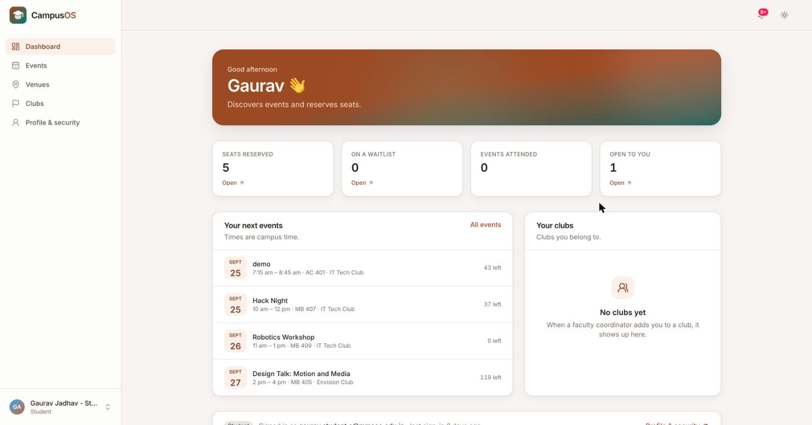
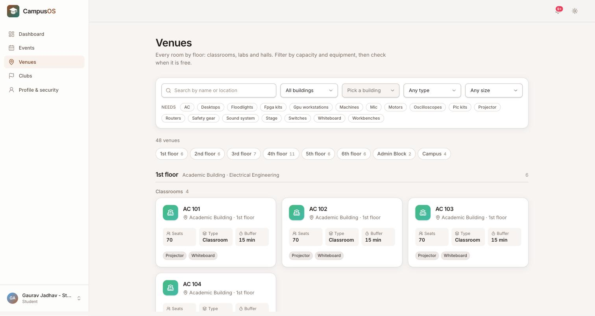
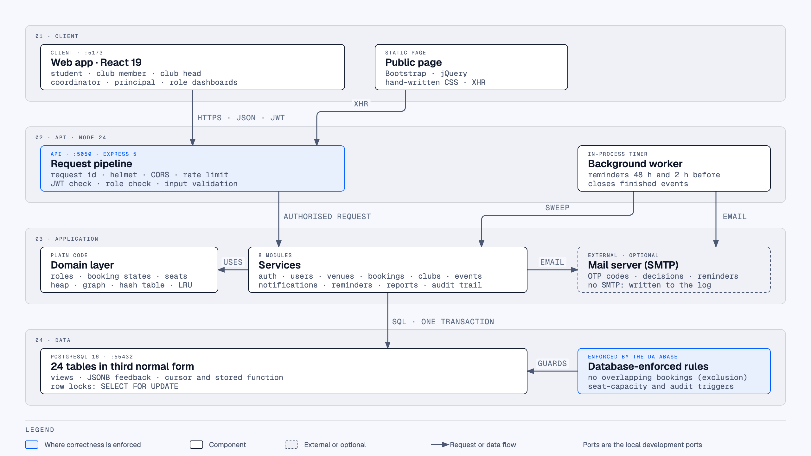
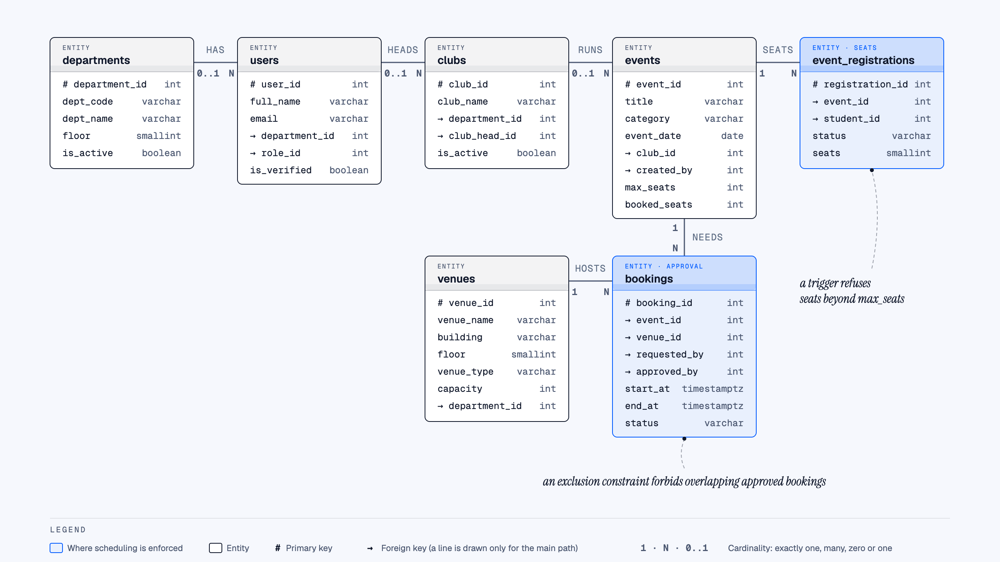
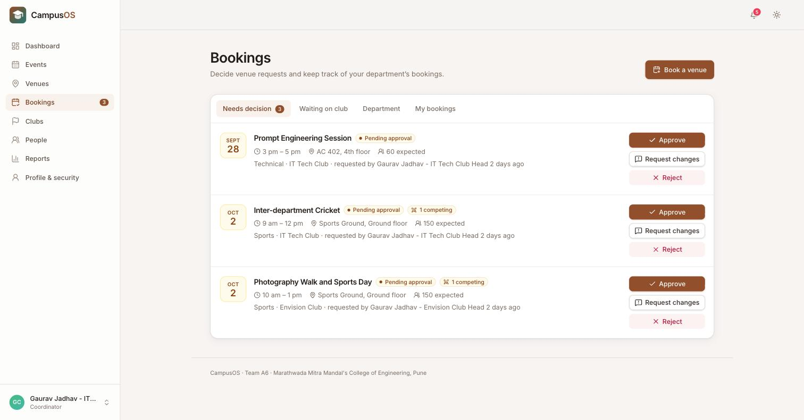
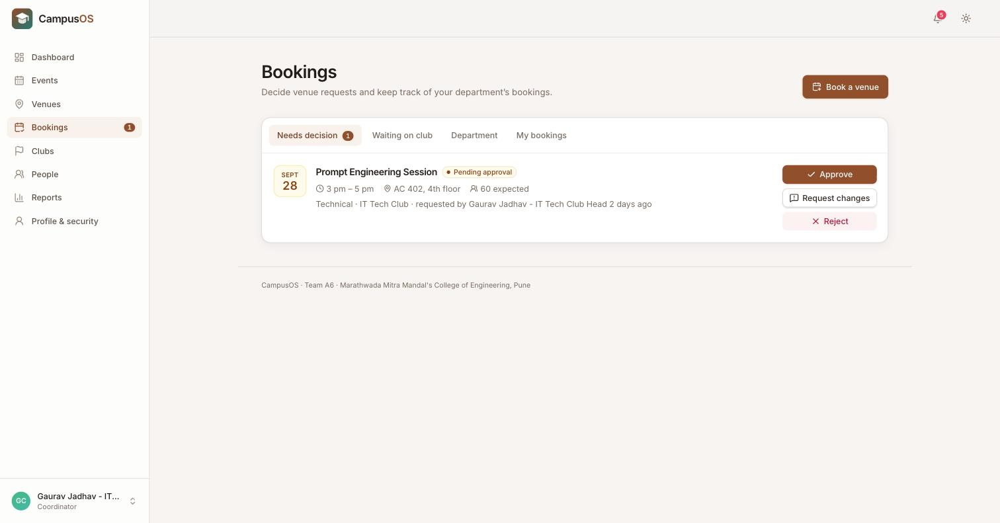
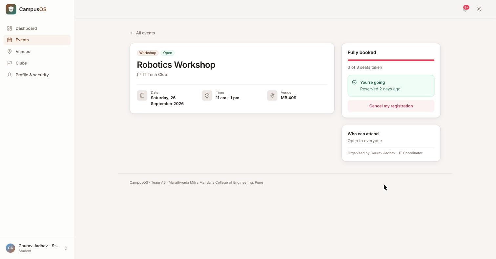
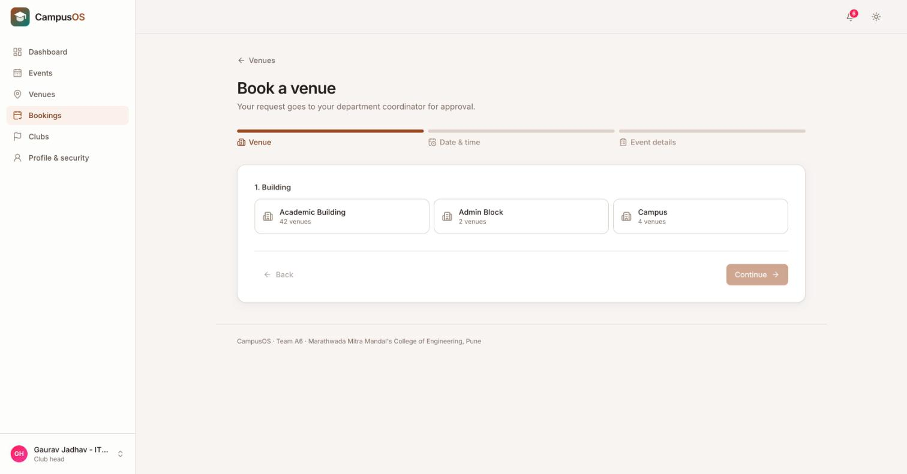
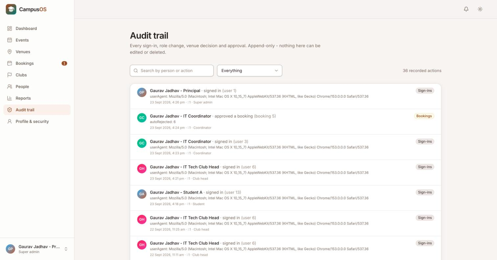

<!--
HOW TO PUT THIS ON MEDIUM (this comment does not show in the preview)

1. Open this file in VS Code and press Cmd+Shift+V to open the preview.
2. Copy the preview's text and paste it into a new Medium story. Headings, bold,
   lists and links come across. Medium uses the first line as the title and the
   italic line under it as the subtitle.
3. Code blocks: if one pastes as plain text, type ``` on an empty line in Medium
   to start a code block and paste the code into it.
4. Images: Medium will not pick them up from the paste. At each image, click "+"
   then the camera icon and upload that file from the repo; the italic line
   under each image is its caption.
5. Tags (Medium allows 5): Web Development, PostgreSQL, Database, Operating Systems, Programming.
6. Remove the GitHub link at the end if the repository is private.
-->

# From Syllabus to Software: How We Built CampusOS at MMCOE

*How a second-year IT team turned DBMS, OS, DSA and OOP from exam topics into a working campus platform.*


*The student dashboard in CampusOS.*

Team A6, Department of Information Technology, MMCOE Pune · Guide: Prof. Nishanti C. Naidu · B25IT304 Project Based Learning, A.Y. 2025-26

---

## The problem we started with

Ask any club head at our college how they book a seminar hall for an event and you will hear the same story. Fill in a paper form. Get it signed. Wait three to five days. Then find out on the day that another club was told the same hall was free.

Students have their own version of it. Workshop notices are scattered across a dozen WhatsApp groups, there is no way to reserve a seat, and a popular session is either overcrowded or half empty. Faculty, meanwhile, have no single place to see which rooms are free, who approved what, or how many people actually turned up.

So for our Project Based Learning course we set out to build **CampusOS**, a web platform that puts the whole path in one place:

**A club requests a venue → faculty approve it → the event is published → students reserve seats → reminders go out → reports and an audit trail are kept.**

When we opened the syllabus we found that our own curriculum already describes this project. Under *B25IT405 Website Development and Hosting*, PBL topic P5 reads:

> "Develop an end-to-end event management system where users can create events, manage registrations, and track attendance. The platform should support features like ticketing, notifications, and analytics."

That is CampusOS, written down by the department before we wrote a line of code.

---

## The rule we set ourselves

Early on our guide made the department's goal clear: **this is not meant to be an advanced or AI project.** The point is to apply what we learn in second year, theory and lab both, correctly and visibly.

That changed how we built everything. Before adding anything we asked one question:

> Is this the simplest thing a second-year student would recognise from their own syllabus?

In practice that meant:

- We wrote the data structures the syllabus names ourselves, instead of relying on a clever JavaScript built-in.
- We wrote reports as plain `GROUP BY` / `HAVING` / `JOIN` queries, not window functions.
- We used real class inheritance and method overriding where the OOP unit calls for it, instead of long `if/else` chains.
- **No AI or machine learning anywhere.** Even the event recommendations are a ranking by the student's own registration history, and the screen shows the reason for each one.

We also followed a second rule: **we used a topic only where the project had a real job for it.** That is why you will not find a stack or a binary search tree in CampusOS. Nothing in a booking system needs them, and adding one just to tick a box would be a demo file, not an application of the course.

---

## What CampusOS does

There are five roles, and they inherit from each other the way the college actually works:

- **Student:** sign up with a college email verified by a one-time code, browse events, reserve or cancel a seat, get reminders 48 hours and 2 hours before, leave anonymous feedback.
- **Club member:** everything a student can, plus see the club's bookings.
- **Club head:** request a venue with a live clash check, publish events, mark attendance, read feedback.
- **Department coordinator (faculty):** approve, reject or send back venue requests, manage venues and clubs in their department, export reports.
- **Principal / HOD:** everything above for the whole college, plus the audit trail.

Venues are shown floor by floor, the way our academic building is laid out: one department per floor, each with its own classrooms, labs and halls.


*Venues are listed floor by floor, matching the real academic building.*

**The stack:** React 19 with Vite and Tailwind for the web app, Node.js 24 with Express 5 for the API, and PostgreSQL 16 for the database. We used plain SQL through the `pg` driver with no ORM, so every query the syllabus teaches is visible in the code.


*Every request passes the same checks before the API does any work, and the rules that must never break are enforced by the database itself.*

---

## Syllabus to code, one subject at a time

This is the part we are proudest of. Every topic below is used by a real feature and covered by tests.

### Database Management Systems: where the rules live

DBMS is the strongest subject in the project. The database has **24 tables, 38 foreign keys, 41 check constraints, 4 views, 8 triggers and 5 stored functions**.


*The core of the schema: from a venue request to a reserved seat.*

**Normalisation, the real way.** Our first design stored an event's eligible departments and eligible years as arrays inside one column. That breaks first normal form: you can't join on an array, index it properly or put a foreign key on it. So we split them into junction tables with **composite primary keys**:

```sql
CREATE TABLE event_eligible_departments (
    event_id        INTEGER NOT NULL,
    department_id   INTEGER NOT NULL,
    PRIMARY KEY (event_id, department_id),
    FOREIGN KEY (event_id) REFERENCES events(event_id) ON DELETE CASCADE,
    FOREIGN KEY (department_id) REFERENCES departments(department_id) ON DELETE CASCADE
);
```

We also kept departments and years in **two separate tables**, not one combined table. They are independent facts about an event, so storing them together would force every department to be paired with every year, a cartesian product. That is exactly the fourth-normal-form problem from our textbook, and seeing it in our own schema made 4NF make sense in a way the lecture slides had not.

**Letting the database say no.** The rule that matters most, "no two approved bookings for the same room at the same time", is not just checked in JavaScript. PostgreSQL enforces it with an **exclusion constraint**:

```sql
CONSTRAINT excl_bookings_no_overlap
    EXCLUDE USING gist (
        venue_id WITH =,
        tstzrange(start_at, end_at, '[)') WITH &&
    ) WHERE (status = 'APPROVED')
```

Application code can have bugs. A constraint can't be bypassed. So the rules that must never break live in the database, and the code is the friendly layer on top.

**Every query form from the syllabus, used for a reason:**

- **HAVING** in the club activity view, to drop clubs that have never run an event (you can't do that with `WHERE`, because the count doesn't exist until after `GROUP BY`).
- **UNION** for "My activity": events I registered for, combined with events I created.
- **NOT IN** for the attendance shortlist: registered students not yet marked present.
- **A self-join** for "related events" from the same club.
- **Triggers** that refuse overbooking and make the audit log **append-only**. Even running `UPDATE admin_logs …` directly in psql is rejected.
- **A cursor** in `close_past_events()`, which walks finished events row by row and marks them completed.
- **Transactions and row locks** (`SELECT … FOR UPDATE`), so an approval updates the booking, the event and the audit log all at once or not at all.

**One honest substitution.** The syllabus asks for MongoDB. Event feedback really is semi-structured (the follow-up questions differ by event type), but running a second database server for one table felt like too much. So we stored the answers as **JSONB with a GIN index** inside PostgreSQL. It covers the same ideas (flexible documents, document indexing, aggregation), and we documented it as a substitution rather than pretending it is MongoDB.


*Two clubs asked for the same venue at the same time. Both requests wait in the faculty inbox.*


*Approving one rejects the other automatically, with the reason, inside one transaction.*

### Operating Systems: the deadlock we actually had

The best story in this project is a bug.

Two operations change the same pair of rows, a **club** and a **user**:

- **"Add a member to a club"** locked the **club** row first, then the **user** row.
- **"Change a user's role"** (old code) locked the **user** row first, then the **club** row.

Run them at the same moment on the same club and user, and you get:

```
T1 addMember:  holds club C ─── waits for user U
T2 changeRole: holds user U ─── waits for club C
```

Neither can continue. That is a **deadlock**, and when we mapped it against the four Coffman conditions from our OS unit, all four were there:

1. **Mutual exclusion:** `FOR UPDATE` gives one transaction exclusive use of a row.
2. **Hold and wait:** each transaction keeps its first row while asking for the second.
3. **No preemption:** PostgreSQL never takes a lock away from a running transaction.
4. **Circular wait:** T1 waits for T2 while T2 waits for T1.

The first three are the price of correct locking; we need them. So we broke the fourth. We wrote down **one global lock order** that every transaction must follow:

```
venues → bookings → events → event_registrations → clubs → club_members → users
```

That's **deadlock prevention by resource ordering**, straight out of the textbook. Then we wrote a test that fires 15 of each operation at once. Against the old code it failed with PostgreSQL's deadlock error (`40P01`); against the fix it passes every time.

The same unit shows up elsewhere too:

- **Critical sections and mutual exclusion:** everything between a row lock and `COMMIT`. A test fires **20 approvals at the same instant, and exactly one wins.**
- **Counting semaphore:** an event's free seats are the semaphore value. Reserving a seat is `P` (take one or join the waitlist), cancelling is `V` (free one and wake the next person who fits). **Twenty students race for the last seat; exactly one gets it.**
- **CPU scheduling:** the faculty approval inbox can be ordered by **FCFS, SJF or priority**, treating requests as processes and the approver as the CPU. It also shows waiting and turnaround time for each policy, and our tests reproduce the textbook example figures.
- **LRU page replacement:** a small cache for settings and venue rows, built on a hand-written doubly linked list and hash table, with hit and miss counts you can check.
- **Shell scripting:** bash scripts to reset, back up and demo the database, with arguments, loops and exit codes.


*When the seats run out, the system refuses. It cannot be oversold.*

We found a second bug of the same kind: two people clicking "Publish" together each passed the "not yet published" check, so every student was notified twice. That is a check-then-act race outside the critical section, and the fix was to take the lock *before* checking.

### Data Structures and Algorithms: hand-written, and actually used

All of these live in `backend/src/lib/ds/`, each with its own tests:

- **Circular queue:** the event waitlist. First come, first served, with O(1) add and remove.
- **Merge sort + binary search:** suggesting the nearest free time when your slot is taken.
- **Binary min-heap:** picking the top 20 recommendations without sorting everything.
- **Tree with pre-, post- and level-order traversal:** the campus → building → floor → venue hierarchy.
- **Graph with BFS and Dijkstra:** "nearest free venue" by walking distance.
- **Hash table with chaining:** counting a student's registrations by category.

We did not take it on trust that they were correct. For example, the binary-search slot finder is checked against the slow linear version on **3,000 random days** and must give identical answers, and Dijkstra is checked against Floyd–Warshall on 200 random graphs.

To be honest about it: most inputs in a college booking system are small, so these structures are correct and easy to demonstrate rather than measurably faster.


*The slot is taken, so CampusOS suggests the nearest free times, found with merge sort and binary search.*

### Object-Oriented Programming: replacing if chains with classes

The role rules used to look roughly like this, repeated across the code:

```js
if (actor.role === ROLES.SUPER_ADMIN) { ... }
else if (actor.role === ROLES.DEPT_COORDINATOR) { ... }
```

We replaced them with a class hierarchy that mirrors the college:

```
User → Student → ClubMember → ClubHead                    (multilevel inheritance)
User → Faculty (abstract) → DeptCoordinator / SuperAdmin  (hierarchical)
```

Each class **overrides** the rules that differ for it:

```js
class DeptCoordinator extends Faculty {
  canManageClub(club) {
    return club.departmentId !== null && this.#ownsDepartment(club.departmentId);
  }
  #ownsDepartment(departmentId) { ... }   // private method
}

class SuperAdmin extends Faculty {
  canManageClub() { return true; }
}
```

The same call, `user.canManageClub(club)`, gives a different answer depending on the object's class. That's runtime polymorphism, the "virtual functions" unit, applied to our own problem. A booking is also a small **state-machine class**: its status is a `#private` field that can only change through `approve()`, `reject()` or `cancel()`, so an illegal jump like *rejected → approved* is simply impossible.

Our syllabus teaches OOP in C++ and our backend is JavaScript. Some C++ features (operator overloading, destructors, `protected`) don't exist in JavaScript, so we marked them as not applicable instead of faking them.

### Computer Networks and Web Technology

- **HTTP done properly:** the right methods and status codes (`201` created, `409` conflict when a slot is taken, `429` when you try too many logins).
- **Cookies, headers and CORS:** the refresh token sits in an `httpOnly`, `SameSite=Strict` cookie that JavaScript can't read, and the API only accepts requests from a fixed list of origins.
- **SMTP:** one-time codes and approval decisions go out by email.
- **Bootstrap, jQuery and XMLHttpRequest:** the syllabus names them specifically, so our public "About" page uses all three, plus hand-written CSS with Grid, Flexbox and media queries, without rewriting the main React app.
- **Validation on both sides:** names, Indian mobile numbers and emails are checked in the browser for instant feedback *and* on the server, because a server should never trust the browser.

### Security, in plain terms

- Passwords are stored as **bcrypt** hashes, never as plain text.
- Login tokens expire in 15 minutes, and if someone reuses an old refresh token, the whole session is revoked.
- Sign-in is **rate limited** to stop password guessing.
- Every SQL query is **parameterised**, so SQL injection isn't possible.
- Every decision is written to an audit log that **nobody can edit**, not even the principal and not even directly in the database.


*Every decision is recorded, and a database trigger refuses any attempt to edit or delete it.*

---

## How we know it works

- **1,278 automated tests** (1,030 backend, 248 frontend), none failing, none skipped.
- **98.7%** of backend statements covered by tests.
- **Concurrency proofs:** 20 approvals at once → 1 winner. 20 students, 1 seat → 1 seat taken. 15 + 15 opposite-order operations at once → no deadlock.
- **Continuous integration:** every push runs every test against a real PostgreSQL database.

The concurrency tests are the important ones, because a race condition can't be proved against a fake database. Ours run against real PostgreSQL.

---

## Things that tripped us up

Not everything was about algorithms. A few lessons came the hard way:

- **The login that "didn't work".** Our API originally ran on port 5000. On macOS that port belongs to the AirPlay Receiver, which answers every request with `403 Forbidden`. It looked exactly like a broken login, and we spent far too long debugging our authentication code before we found it. The API now runs on 5050.
- **The test that lied.** Our database tests skip themselves when PostgreSQL isn't running, and the summary still prints the full test count. We learned to read "N passed" carefully: a skipped test is a false green, not a pass.
- **"It looks like an AI template."** A faculty reviewer pointed out that our first colour palette, a popular stock design kit, made the app look like every generic SaaS product. We replaced it with our own palette, "Clay & Teal", and re-checked every text colour for readability (WCAG AA contrast).

---

## What we deliberately left out

Saying what you *didn't* build matters as much as what you did:

- **No AI/ML**, by design.
- **Not deployed.** It runs locally, so hosting, DNS and HTTPS are out of scope.
- **Not load-tested** at the 500 concurrent users our requirements document targets.
- **Sign-up for students from other colleges** (part of requirement FR1) is planned as email plus a one-time code, but not built yet. 20 of our 21 functional requirements are complete.
- **Some campus data is placeholder.** Room names on the IT floor are real; other floors' labs, capacities and walking distances are not yet.
- **No formal UX research.** We have accessible components and dark mode, but no personas, wireframes or usability test, and we would rather say so than claim it.

---

## What we learned

The biggest lesson wasn't any single topic. It was that **the syllabus subjects are not separate boxes.** The deadlock was an OS problem that showed up in database code and was fixed by a rule written in our project docs. The seat counter is a semaphore (OS), protected by a row lock (DBMS), with a waitlist that is a circular queue (DSA), checked by a class with private state (OOP). Seeing them work together in one system taught us more than studying each one separately for an exam.

We also learned to be honest about limits. A clear "we did not do this, and here is why" earned more trust in our reviews than a feature list ever did.

**What's next:** sign-up for other colleges' students, real room data for every floor, load testing, and QR-code check-in at events.

---

## Acknowledgements

CampusOS was built by Team A6, Department of Information Technology, Marathwada Mitra Mandal's College of Engineering (MMCOE), Pune.

Thanks to our guide, **Prof. Nishanti C. Naidu**, for pushing us to apply our fundamentals properly instead of reaching for something flashy.

**Source code:** [github.com/GgauravJ05/campusOS](https://github.com/GgauravJ05/campusOS)
